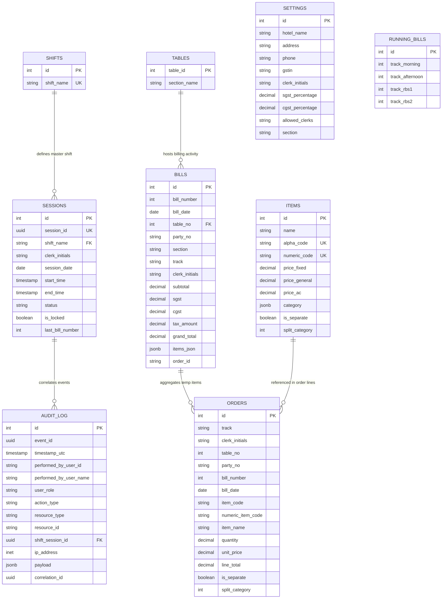

# Restaurant Billing System (RBS) - Database Design Document

## 1. Document Control & Overview

| Attribute | Details |
| :--- | :--- |
| **System Name** | Restaurant Billing System (RBS) |
| **Document Version** | 1.0.0 |
| **Database Engine** | PostgreSQL 12+ |
| **Extensions Required** | `uuid-ossp` |
| **Primary Architecture** | Hybrid Relational + Document (JSONB) |
| **Date** | September 29, 2026 |

### 1.1 Purpose
This document provides a comprehensive specification of the database schema, entity relationships, constraints, stored functions, views, indexing strategies, and security measures for the **Restaurant Billing System (RBS)**. It serves as the authoritative blueprint for database administrators, backend developers, and system architects.

---

## 2. System Architecture & Database Design Principles

The RBS database is designed for high throughput, POS hardware integration (thermal receipt printers, clerk terminals), multi-shift operational tracking, and strict financial auditing.

### 2.1 Core Architectural Principles
1. **Hybrid Data Modeling**: Uses structured SQL tables for relational integrity (sessions, tables, bills) and PostgreSQL `JSONB` for multi-category item tagging and historical bill item snapshot immutability.
2. **Shift-Based Session Isolation**: Billing sequences and operations are partitioned across explicit shifts (`'` Morning, `''` Afternoon, `RBS1`, `RBS2`) tied to clerk initials and session dates.
3. **Atomic Order Lifecycle**: Active table orders reside temporarily in the `orders` table and are atomically aggregated, snapshotted, and moved into `bills.items_json` via stored procedures (`move_orders_to_bill_json`) upon bill generation.
4. **Multi-Pricing Tier Support**: Menu items support tiered pricing models (`price_fixed`, `price_general`, `price_ac`) based on seating sections (General vs. AC).
5. **Comprehensive Audit Trail**: System actions and financial overrides are logged asynchronously/synchronously into `audit_log` with correlation IDs and JSON payloads.

---

## 3. Entity Relationship Diagram (ERD)



---

## 4. Detailed Table Schemas (Data Dictionary)

### 4.1 `settings`
Stores hotel/restaurant master configurations, tax percentages, and clerk permissions.

| Column | Type | Constraints | Default | Description |
| :--- | :--- | :--- | :--- | :--- |
| `id` | `SERIAL` | `PRIMARY KEY` | Nextval | Unique settings ID |
| `hotel_name` | `VARCHAR(255)` | `NOT NULL` | `'Restaurant Name'` | Restaurant header name for printed bills |
| `address` | `TEXT` | `NULLABLE` | `NULL` | Business address printed on invoice |
| `phone` | `VARCHAR(20)` | `NULLABLE` | `NULL` | Contact telephone number |
| `gstin` | `VARCHAR(20)` | `NULLABLE` | `NULL` | GST Registration Number |
| `clerk_initials` | `VARCHAR(50)` | `UNIQUE` | `'CLK'` | Default system clerk code |
| `sgst_percentage` | `DECIMAL(5,2)` | `NOT NULL` | `2.50` | State GST percentage |
| `cgst_percentage` | `DECIMAL(5,2)` | `NOT NULL` | `2.50` | Central GST percentage |
| `allowed_clerks` | `TEXT` | `NOT NULL` | `'CLK,V,P,B'` | CSV string of active/authorized clerk initials |
| `section` | `VARCHAR(10)` | `NOT NULL` | `'L'` | Default terminal section code |
| `created_at` | `TIMESTAMPTZ` | `NOT NULL` | `CURRENT_TIMESTAMP` | System record creation timestamp |

---

### 4.2 `items`
Catalog of food and beverage items with dual item codes (alphanumeric & numeric) and location-based pricing.

| Column | Type | Constraints | Default | Description |
| :--- | :--- | :--- | :--- | :--- |
| `id` | `SERIAL` | `PRIMARY KEY` | Nextval | Internal item ID |
| `name` | `VARCHAR(255)` | `NOT NULL` | — | Full menu item name |
| `alpha_code` | `VARCHAR(20)` | `UNIQUE` | `NULL` | Quick alpha lookup code (e.g. `'D1'`, `'CB'`) |
| `numeric_code` | `VARCHAR(20)` | `UNIQUE` | `NULL` | Numerical POS keypad code (e.g. `'101'`) |
| `price_fixed` | `DECIMAL(10,2)` | `NOT NULL` | `0.00` | Fixed standard base price |
| `price_general` | `DECIMAL(10,2)` | `NOT NULL` | `0.00` | Price applied for General dining section |
| `price_ac` | `DECIMAL(10,2)` | `NOT NULL` | `0.00` | Price applied for Air Conditioned dining section |
| `category` | `JSONB` | `CHECK` | `'[]'::jsonb` | Categorization tags JSON array (e.g. `[{"name":"South Indian"}]`) |
| `is_separate` | `BOOLEAN` | `NOT NULL` | `FALSE` | Flag for printing on separate KOT ticket |
| `split_category` | `INTEGER` | `NOT NULL` | `0` | Sub-kitchen routing identifier |
| `created_at` | `TIMESTAMPTZ` | `NOT NULL` | `CURRENT_TIMESTAMP` | Record creation timestamp |

> **Constraint**: `chk_category_format CHECK (category IS NULL OR jsonb_typeof(category) = 'array')`

---

### 4.3 `shifts`
Master lookup table defining valid operational work shifts.

| Column | Type | Constraints | Default | Description |
| :--- | :--- | :--- | :--- | :--- |
| `id` | `SERIAL` | `PRIMARY KEY` | Nextval | Shift ID |
| `shift_name` | `VARCHAR(20)` | `UNIQUE, NOT NULL, CHECK` | — | Shift code (`'` Morning, `''` Afternoon, `RBS1`, `RBS2`) |
| `created_at` | `TIMESTAMPTZ` | `NOT NULL` | `CURRENT_TIMESTAMP` | Registration timestamp |

---

### 4.4 `sessions`
Tracks daily work shifts open/closed by specific clerks, tracking bill counter states.

| Column | Type | Constraints | Default | Description |
| :--- | :--- | :--- | :--- | :--- |
| `id` | `SERIAL` | `PRIMARY KEY` | Nextval | Session auto-increment ID |
| `session_id` | `UUID` | `UNIQUE, NOT NULL` | `uuid_generate_v4()` | Globally unique session UUID |
| `shift_name` | `VARCHAR(20)` | `FK -> shifts(shift_name)` | — | Associated master shift name |
| `clerk_initials` | `VARCHAR(10)` | `NOT NULL` | — | Clerk managing the session |
| `session_date` | `DATE` | `NOT NULL` | — | Date of shift operations |
| `start_time` | `TIMESTAMPTZ` | `NOT NULL` | `CURRENT_TIMESTAMP` | Time shift opened |
| `end_time` | `TIMESTAMPTZ` | `NULLABLE` | `NULL` | Time shift closed |
| `status` | `VARCHAR(10)` | `NOT NULL, CHECK` | `'OPEN'` | Status (`'OPEN'`, `'CLOSED'`) |
| `closed_by` | `VARCHAR(50)` | `NULLABLE` | `NULL` | User/Clerk closing shift |
| `is_locked` | `BOOLEAN` | `NOT NULL` | `FALSE` | Prevents further edits after day-end close |
| `last_bill_number` | `INTEGER` | `NOT NULL` | `0` | High-water mark bill sequence counter for session |
| `created_at` | `TIMESTAMPTZ` | `NOT NULL` | `CURRENT_TIMESTAMP` | Record timestamp |

> **Unique Composite Key**: `UNIQUE(shift_name, session_date, clerk_initials)`

---

### 4.5 `tables`
Maps dining tables to restaurant physical sections (e.g. Parcel, General, AC).

| Column | Type | Constraints | Default | Description |
| :--- | :--- | :--- | :--- | :--- |
| `table_id` | `INTEGER` | `PRIMARY KEY` | — | Physical table number (e.g. 1 = Parcel, 2-14 = General, 15-30 = AC) |
| `section_name` | `VARCHAR(100)`| `NOT NULL` | — | Section name (`'Parcel'`, `'General'`, `'AC'`) |
| `created_at` | `TIMESTAMPTZ` | `NOT NULL` | `CURRENT_TIMESTAMP` | Created date |
| `updated_at` | `TIMESTAMPTZ` | `NOT NULL` | `CURRENT_TIMESTAMP` | Last updated date |

---

### 4.6 `bills`
Permanent transaction repository containing finalized invoices and snapshotted item line details in `JSONB`.

| Column | Type | Constraints | Default | Description |
| :--- | :--- | :--- | :--- | :--- |
| `id` | `SERIAL` | `PRIMARY KEY` | Nextval | Unique bill record ID |
| `bill_number` | `INTEGER` | `NOT NULL` | — | Sequential invoice number within shift/track |
| `bill_date` | `DATE` | `NOT NULL` | — | Official date of invoice creation |
| `table_no` | `INTEGER` | `FK -> tables(table_id)`| `NULL` | Dining table number |
| `party_no` | `VARCHAR(20)` | `NOT NULL` | `'1'` | Split group / party identifier at table |
| `section` | `VARCHAR(10)` | `NOT NULL` | `'G'` | Section indicator (`'G'`, `'AC'`, `'P'`) |
| `track` | `VARCHAR(20)` | `NOT NULL` | — | Shift track identifier |
| `clerk_initials` | `VARCHAR(10)` | `NOT NULL` | — | Operating clerk initials |
| `subtotal` | `DECIMAL(10,2)` | `NOT NULL` | `0.00` | Net total before tax |
| `sgst` | `DECIMAL(10,2)` | `NOT NULL` | `0.00` | SGST amount calculated |
| `cgst` | `DECIMAL(10,2)` | `NOT NULL` | `0.00` | CGST amount calculated |
| `tax_amount` | `DECIMAL(10,2)` | `NOT NULL` | `0.00` | Combined tax amount (`sgst + cgst`) |
| `grand_total` | `DECIMAL(10,2)` | `NOT NULL` | `0.00` | Total bill amount payable |
| `items_json` | `JSONB` | `NULLABLE` | `NULL` | Snapshotted array of ordered items, quantities, rates, and categories |
| `order_id` | `VARCHAR(50)` | `NULLABLE` | `NULL` | POS reference correlation ID |
| `created_at` | `TIMESTAMPTZ` | `NOT NULL` | `CURRENT_TIMESTAMP` | Invoice creation timestamp |

> **Unique Constraints**:
> - `CONSTRAINT bills_bill_number_bill_date_track_key UNIQUE (bill_number, bill_date, track)`
> - `CONSTRAINT uq_bills_composite_key UNIQUE (table_no, party_no, created_at, track, clerk_initials)`

---

### 4.7 `orders`
Staging table storing unbilled active order items for tables before bill finalization.

| Column | Type | Constraints | Default | Description |
| :--- | :--- | :--- | :--- | :--- |
| `id` | `SERIAL` | `PRIMARY KEY` | Nextval | Order line ID |
| `track` | `VARCHAR(20)` | `NOT NULL` | — | Active shift track |
| `clerk_initials` | `VARCHAR(10)` | `NOT NULL` | — | Ordering clerk code |
| `table_no` | `INTEGER` | `NOT NULL` | — | Dining table number |
| `party_no` | `VARCHAR(20)` | `NOT NULL` | `'1'` | Party split number |
| `bill_number` | `INTEGER` | `NOT NULL` | — | Target bill sequence number |
| `bill_date` | `DATE` | `NOT NULL` | `CURRENT_DATE` | Order creation date |
| `item_code` | `VARCHAR(20)` | `NULLABLE` | `NULL` | Alphanumeric item code |
| `numeric_item_code`| `VARCHAR(20)` | `NULLABLE` | `NULL` | Numeric item code |
| `item_name` | `VARCHAR(255)` | `NULLABLE` | `NULL` | Item display name |
| `quantity` | `NUMERIC(10,2)` | `NOT NULL` | `1.00` | Item quantity ordered |
| `unit_price` | `DECIMAL(10,2)` | `NOT NULL` | `0.00` | Price per unit |
| `line_total` | `DECIMAL(10,2)` | `NOT NULL` | `0.00` | Total cost (`quantity * unit_price`) |
| `is_separate` | `BOOLEAN` | `NOT NULL` | `FALSE` | Separate ticket flag |
| `split_category` | `INTEGER` | `NOT NULL` | `0` | Kitchen split category |
| `created_at` | `TIMESTAMPTZ` | `NOT NULL` | `CURRENT_TIMESTAMP` | Order line created time |
| `updated_at` | `TIMESTAMPTZ` | `NOT NULL` | `CURRENT_TIMESTAMP` | Order line updated time |

> **Foreign Key**:
> `fk_orders_bills_composite FOREIGN KEY (table_no, party_no, created_at, track, clerk_initials) REFERENCES bills (...) ON DELETE CASCADE ON UPDATE CASCADE`

---

### 4.8 `running_bills`
Singleton counter tracking sequential bill numbers across shift tracks.

| Column | Type | Constraints | Default | Description |
| :--- | :--- | :--- | :--- | :--- |
| `id` | `INT` | `PRIMARY KEY` | `1` | Singleton row index (Fixed at 1) |
| `track_morning` | `INT` | `NOT NULL` | `0` | Last bill sequence for Morning shift (`'`) |
| `track_afternoon`| `INT` | `NOT NULL` | `0` | Last bill sequence for Afternoon shift (`''`) |
| `track_rbs1` | `INT` | `NOT NULL` | `0` | Last bill sequence for RBS1 shift |
| `track_rbs2` | `INT` | `NOT NULL` | `0` | Last bill sequence for RBS2 shift |

---

### 4.9 `audit_log`
Comprehensive immutable audit log recording financial operations, voids, shift closures, and user actions.

| Column | Type | Constraints | Default | Description |
| :--- | :--- | :--- | :--- | :--- |
| `id` | `SERIAL` | `PRIMARY KEY` | Nextval | Unique log entry ID |
| `event_id` | `UUID` | `NOT NULL` | `uuid_generate_v4()` | Unique event ID |
| `timestamp_utc` | `TIMESTAMPTZ` | `NOT NULL` | `CURRENT_TIMESTAMP` | Timestamp of event execution |
| `performed_by_user_id`| `VARCHAR(50)`| `NULLABLE` | `NULL` | User ID executing action |
| `performed_by_user_name`| `VARCHAR(100)`| `NULLABLE` | `NULL` | Full name of user |
| `user_role` | `VARCHAR(20)` | `NULLABLE` | `NULL` | Role (`'ADMIN'`, `'CLERK'`, `'MANAGER'`) |
| `action_type` | `VARCHAR(50)` | `NOT NULL` | — | Action verb (`'CREATE_BILL'`, `'CLOSE_SHIFT'`, `'VOID_ITEM'`) |
| `resource_type` | `VARCHAR(50)` | `NOT NULL` | — | Target entity (`'BILL'`, `'SESSION'`, `'ITEM'`) |
| `resource_id` | `VARCHAR(50)` | `NULLABLE` | `NULL` | Target entity identifier |
| `shift_session_id`| `UUID` | `FK -> sessions(session_id)`| `NULL` | Session context ID |
| `ip_address` | `INET` | `NULLABLE` | `NULL` | Terminal client IP address |
| `payload` | `JSONB` | `NULLABLE` | `NULL` | Extra payload details or state changes |
| `correlation_id`| `UUID` | `NULLABLE` | `NULL` | Distributed transaction trace ID |

---

## 5. Database Views

### 5.1 `pending_bills`
Aggregates currently open, unbilled items per table and party.

```sql
CREATE OR REPLACE VIEW pending_bills AS
SELECT 
    o.table_no, 
    o.party_no,
    get_section_by_table(o.table_no::VARCHAR) AS section_name,
    COUNT(o.id) AS total_items,
    SUM(o.line_total) AS total_amount,
    MIN(o.created_at) AS order_started_at,
    MAX(o.updated_at) AS last_updated_at
FROM orders o 
GROUP BY o.table_no, o.party_no;
```

### 5.2 `table_status`
Provides realtime occupancy metrics for all tables by left-joining `tables` with `pending_bills`.

```sql
CREATE OR REPLACE VIEW table_status AS
SELECT
    t.table_id,
    t.section_name,
    CASE 
        WHEN pb.table_no IS NOT NULL THEN 'OCCUPIED' 
        ELSE 'AVAILABLE' 
    END AS status,
    pb.total_items,
    pb.total_amount,
    pb.order_started_at
FROM tables t
LEFT JOIN pending_bills pb ON t.table_id = pb.table_no
ORDER BY t.table_id;
```

---

## 6. Stored Functions & Procedures

### 6.1 `move_orders_to_bill_json(p_bill_id INTEGER, p_table_no VARCHAR, p_party_no VARCHAR)`
Atomic function that extracts temporary lines from `orders`, builds a structured `JSONB` array containing full item category data, snapshots them into `bills.items_json`, and purges the processed orders.

```sql
CREATE OR REPLACE FUNCTION move_orders_to_bill_json(
    p_bill_id INTEGER, 
    p_table_no VARCHAR(20), 
    p_party_no VARCHAR(20)
) RETURNS INTEGER AS $$
DECLARE
    moved_count INTEGER := 0;
    items_array JSONB;
BEGIN
    SELECT jsonb_agg(
        jsonb_build_object(
            'item_name', o.item_name,
            'item_code_numeric', o.numeric_item_code,
            'item_code_alpha', o.item_code,
            'quantity', o.quantity,
            'fixed_price', o.unit_price,
            'actual_price', o.unit_price,
            'line_total', o.line_total,
            'split_category', COALESCE(o.split_category, i.split_category, 0),
            'categories', COALESCE(i.category, '[]'::jsonb)
        )
    )
    INTO items_array 
    FROM orders o
    LEFT JOIN items i ON (i.alpha_code = o.item_code OR i.numeric_code = o.numeric_item_code)
    WHERE o.table_no::VARCHAR = p_table_no 
      AND o.party_no = p_party_no;

    IF items_array IS NULL OR jsonb_array_length(items_array) = 0 THEN 
        RETURN 0; 
    END IF;

    UPDATE bills 
    SET items_json = items_array 
    WHERE id = p_bill_id;

    WITH deleted AS (
        DELETE FROM orders 
        WHERE table_no::VARCHAR = p_table_no 
          AND party_no = p_party_no 
        RETURNING 1
    )
    SELECT count(*) INTO moved_count FROM deleted;

    RETURN moved_count;
END;
$$ LANGUAGE plpgsql;
```

### 6.2 `get_category_totals_for_date(p_date DATE)`
Generates Category Sales Summary reports by unnesting snapshotted `items_json` in `bills`.

```sql
CREATE OR REPLACE FUNCTION get_category_totals_for_date(p_date DATE)
RETURNS TABLE(
    category_name VARCHAR,
    total_quantity INTEGER
) AS $$
BEGIN
    RETURN QUERY
    SELECT 
        cat->>'name' AS category_name,
        SUM((item->>'quantity')::INTEGER * (cat->>'qty')::INTEGER)::INTEGER AS total_quantity
    FROM bills b
    CROSS JOIN LATERAL jsonb_array_elements(b.items_json) AS item
    CROSS JOIN LATERAL (
        SELECT i.category
        FROM items i
        WHERE i.alpha_code = item->>'item_code_alpha'
           OR i.numeric_code = item->>'item_code_numeric'
        LIMIT 1
    ) AS item_info
    CROSS JOIN LATERAL jsonb_array_elements(item_info.category) AS cat
    WHERE b.bill_date = p_date
    GROUP BY cat->>'name'
    ORDER BY total_quantity DESC;
END;
$$ LANGUAGE plpgsql;
```

### 6.3 `get_current_session_id(p_shift_type VARCHAR, p_target_date DATE, p_clerk_initials VARCHAR)`
Resolves active session UUID based on current time or explicit shift selection.

```sql
CREATE OR REPLACE FUNCTION get_current_session_id(
    p_shift_type VARCHAR DEFAULT NULL, 
    p_target_date DATE DEFAULT NULL, 
    p_clerk_initials VARCHAR DEFAULT NULL
) RETURNS UUID AS $$
DECLARE
    session_uuid UUID;
    v_shift_type VARCHAR;
    v_target_date DATE := COALESCE(p_target_date, CURRENT_DATE);
BEGIN
    v_shift_type := COALESCE(p_shift_type, CASE
        WHEN CURRENT_TIME BETWEEN '06:00:00' AND '11:59:59' THEN '`'
        WHEN CURRENT_TIME BETWEEN '12:00:00' AND '17:59:59' THEN '``'
        WHEN CURRENT_TIME BETWEEN '18:00:00' AND '21:59:59' THEN 'RBS1'
        ELSE 'RBS2' END);

    SELECT s.session_id INTO session_uuid FROM sessions s
    WHERE s.shift_name = v_shift_type 
      AND s.session_date = v_target_date 
      AND s.status = 'OPEN'
      AND (p_clerk_initials IS NULL OR s.clerk_initials = p_clerk_initials)
    ORDER BY s.start_time DESC LIMIT 1;

    RETURN session_uuid;
END;
$$ LANGUAGE plpgsql;
```

---

## 7. Indexing Strategy & Performance Tuning

To ensure sub-millisecond query execution on POS terminals, specific B-Tree, GIN (Generalized Inverted Index), and Partial Indexes are defined:

```sql
-- Bills indexing
CREATE INDEX IF NOT EXISTS idx_bills_date_number ON bills(bill_date, bill_number);
CREATE INDEX IF NOT EXISTS idx_bills_items_json ON bills USING GIN (items_json);
CREATE INDEX IF NOT EXISTS idx_bills_table_no ON bills(table_no);
CREATE UNIQUE INDEX IF NOT EXISTS bills_bill_number_bill_date_unique 
    ON bills(bill_number, bill_date, track) WHERE bill_number > 0;

-- Menu Items indexing
CREATE INDEX IF NOT EXISTS idx_items_codes ON items(alpha_code, numeric_code);
CREATE INDEX IF NOT EXISTS idx_items_category ON items USING GIN (category);

-- Sessions indexing
CREATE INDEX IF NOT EXISTS idx_sessions_shift_date ON sessions(shift_name, session_date);
CREATE INDEX IF NOT EXISTS idx_sessions_status ON sessions(status);
CREATE INDEX IF NOT EXISTS idx_sessions_date ON sessions(session_date);
CREATE INDEX IF NOT EXISTS idx_sessions_locked ON sessions (shift_name, is_locked);

-- Active Orders indexing
CREATE INDEX IF NOT EXISTS idx_orders_table_no ON orders(table_no);
CREATE INDEX IF NOT EXISTS idx_orders_bill_number_date ON orders(bill_number, bill_date);

-- Tables indexing
CREATE INDEX IF NOT EXISTS idx_tables_section_name ON tables(section_name);
```

---

## 8. Data Integrity & Business Rules

1. **Item Snapshot Integrity**: The prices and item labels on bills are locked at invoice generation inside `items_json`. Subsequent menu price alterations in `items` will **never** alter historical invoices.
2. **Sequential Bill Counter**: Shift tracks enforce strict sequential bill numbers per date to eliminate duplicate receipt numbers.
3. **Session Lockdown**: When `sessions.is_locked = TRUE`, no modifications, deletions, or new bills can be posted under that shift session.
4. **GST Accounting**: `bills.tax_amount` is calculated from configurable `settings.sgst_percentage` and `settings.cgst_percentage` (default 2.5% SGST + 2.5% CGST = 5.0% total).

---

## 9. Backup, Maintenance & Data Management

1. **Database Export / Import Utility**: JSON export scripts (`backend/export_db_to_json.js`) enable offline local backup and disaster recovery.
2. **Schema Patching Workflow**: Schema updates are managed via atomic PostgreSQL script executions (`Final.sql`, `update_db.sql`).
3. **Automated Seed Maintenance**: Core shift entries (`'`, `''`, `RBS1`, `RBS2`), default table mappings (1-30), and initial running bill tracking records are automatically initialized if missing.
